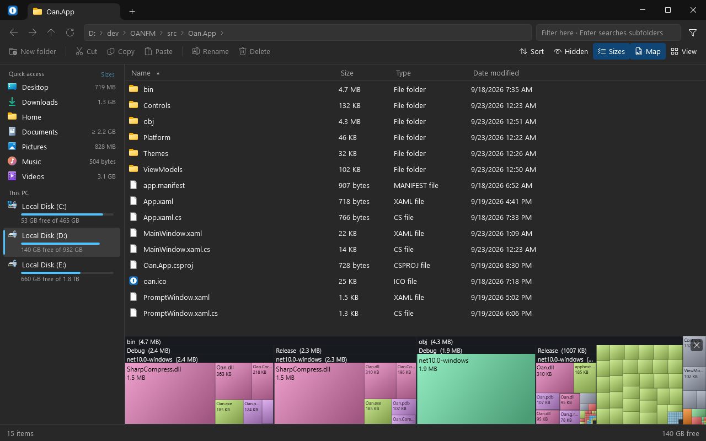

<p align="center">
  
</p>

<h1 align="center">OAN</h1>

<p align="center">
  A file manager for Windows. It shows how big every folder is, opens archives like folders,<br>
  and keeps the menus, dialogs and Recycle Bin you already know from File Explorer.
</p>

<p align="center">
  <a href="https://github.com/ionut27001/OAN-explorer/releases"></a>
  
  <a href="LICENSE"></a>
</p>

<p align="center">
  <a href="https://ionut27001.github.io/OAN-explorer/">Website</a> ·
  <a href="https://github.com/ionut27001/OAN-explorer/releases">Download</a> ·
  <a href="#build-from-source">Build from source</a>
</p>

> [!WARNING]
> **OAN is a work in progress.** This is an early alpha: everyday browsing and file operations
> work, but features are missing, things will change between versions, and there will be bugs.
> Keep a backup of anything you cannot afford to lose.



## What it does today

**Getting around**

- Tabs, each with its own Back and Forward history.
- An address bar of clickable crumbs that turns into a text box when you want to type a path.
- Six views: details, list, and four sizes of icons with thumbnails.
- A sidebar with your usual folders and every drive, with how full it is.
- Type to filter the folder you are in, narrow it to documents, images, audio, video, archives or
  code, or press Enter to search the subfolders by name.
- The list follows the disk: when something changes in the folder, it shows up on its own.

**Working with files**

- Copy, cut, paste, rename, delete, new folder, drag and drop. These are carried out by the same
  Windows component File Explorer uses, so you get the Recycle Bin, the familiar progress and
  "replace or skip" dialogs, and Ctrl+Z in Explorer can undo them.
- The real Windows right-click menu, with the entries your installed programs add to it.
- The same New ▸ file templates as Explorer, Copy as path, and Properties.

**Seeing where the space went**

- Folder sizes right in the Size column, kept up to date as the contents change.
- A size map: the folder drawn as rectangles, biggest first, coloured by kind of file.

**Archives and disk images**

- zip, 7z, rar and tar open like folders. Extract them, or compress a selection to zip.
- If you have [7-Zip](https://7-zip.org) installed, OAN uses it for the formats and features the
  built-in readers lack: cab, wim, zst, passwords, split volumes.
- Opening an `.iso` mounts it as a drive; eject it from the sidebar.

**Looks**

- Light and dark, following Windows.
- The Windows 11 window materials: Mica, Mica Alt, Acrylic, or plain solid.
- Themes are plain `.json` files — colours, font, a background picture, where the sidebar and
  toolbar sit. Copy the example, change what you like.

## Not there yet

- Searching *inside* files. The engine and its tests exist; the window has no switch for it yet.
- Instant folder sizes for a whole drive, the way WizTree does it. That means reading the disk's
  index directly, which needs administrator rights, so it belongs in a separate helper.
- Indexed, instant search.
- Two panes side by side.
- FTP and other remote locations.
- An installer, automatic updates, a signed executable.
- Any language other than English.

## Download

1. Get the newest zip from [Releases](https://github.com/ionut27001/OAN-explorer/releases).
2. Unzip it anywhere.
3. Run `Oan.exe`.

There is no installer and nothing else to install — .NET is included in the zip. Built and tested
on Windows 11, x64; Windows 10 is untested.

OAN is not code-signed, so the first time Windows may say *"Windows protected your PC"*. Choose
**More info → Run anyway**.

Settings and themes are kept in `%AppData%\OAN`. To remove OAN, delete the unzipped folder and
that one.

## Keyboard

| | |
|---|---|
| Back / Forward / Up | `Alt+←` / `Alt+→` / `Alt+↑` (or `Backspace`) |
| Type a path | `Ctrl+L`, `Alt+D` or `F4` |
| Filter and search | `Ctrl+F`, `Ctrl+E` or `F3` — then `Enter` to search subfolders |
| New tab / Close tab | `Ctrl+T` / `Ctrl+W` |
| Next / Previous tab | `Ctrl+Tab` / `Ctrl+Shift+Tab` |
| Copy / Cut / Paste | `Ctrl+C` / `Ctrl+X` / `Ctrl+V` |
| Copy as path | `Ctrl+Shift+C` |
| Rename | `F2` |
| Delete / Delete permanently | `Del` or `Ctrl+D` / `Shift+Del` |
| New folder | `Ctrl+Shift+N` |
| Properties | `Alt+Enter` |
| Refresh | `F5` |
| Change the view | `Ctrl` + mouse wheel |
| Settings | `Ctrl+,` |

## Build from source

You need Windows and the [.NET 10 SDK](https://dotnet.microsoft.com/download).

```bash
git clone https://github.com/ionut27001/OAN-explorer.git
cd OAN-explorer
dotnet run --project src/Oan.App
```

Tests. The first is the normal run; the second is a finishing step, taken once a mechanism works
— a line limit going red halfway through building one gets in the way of building it.

```bash
dotnet test
dotnet test --filter "Category=Shape"
```

## How it is put together

C# / .NET 10 / WPF.

```
Oan.slnx
  src/Oan.Core     no UI, no WPF reference — listing, places, history, file operations
  src/Oan.App      the window: XAML, view models, shell hosting
  tests/Oan.Tests  xunit
```

### Two rules the code follows

**Unknown is null, never zero.** A size that could not be read is `null` and renders as `—`.
It is never `0 bytes`. A listing that skipped unreadable entries carries `Skipped`; one that
failed outright carries `Error`. "Empty" and "we do not know" are different answers and the
window must not give the same one for both.

**Nothing in the window is inert.** A button that is visible and does nothing is worse than a
missing feature, because the user cannot tell it from a fast success. Controls that cannot act
are `IsEnabled=false`.

### Shell integration

File operations go through **IFileOperation**, the same interface Explorer uses. That is what
gives the Recycle Bin, the progress and conflict dialogs, undo in Explorer's own Ctrl+Z stack,
and the permanent-delete confirmation — which lives outside this process and so cannot be
spoofed or suppressed by anything in the app. Icons and the context menu come from the shell
for the same reason.

The one trap worth knowing: `IFileOperation.PerformOperations` returns `S_OK` when the user
cancels and when individual items fail. `GetAnyOperationsAborted()` and an
`IFileOperationProgressSink` are what tell you which actually happened.

### Archives

Zip comes from the framework; 7z, rar, tar and the single-stream kinds from SharpCompress (MIT).
When the user has 7-Zip installed, its `7z.dll` is loaded from there and takes 7z and rar —
every method, solid blocks read once, split volumes, passwords — plus cab, wim, zst and the
rest. OAN ships no 7-Zip of its own, so it carries no LGPL obligation; without one installed the
managed readers carry on alone. Extraction never overwrites and never leaves its destination.
Compression is zip only.

### Measured before it was built

Most mechanisms here were measured first and written second. The numbers are kept:

- [Folder sizes](docs/folder-size-baseline.md) — what walking a folder costs
- [The size map](docs/treemap.md) — why squarified, and what drawing it costs
- [Search](docs/search-baseline.md) — the baselines the engine was written against
- [Thumbnails and overlays](docs/thumbnails.md)
- [Icons](docs/icons.md)
- [Shortcuts, links and long paths](docs/shortcuts-and-links.md)

## Licence

[MIT](LICENSE) © 2026 Oancea Ionut Eugen.

OAN uses [SharpCompress](https://github.com/adamhathcock/sharpcompress) (MIT). 7-Zip is not
bundled.
